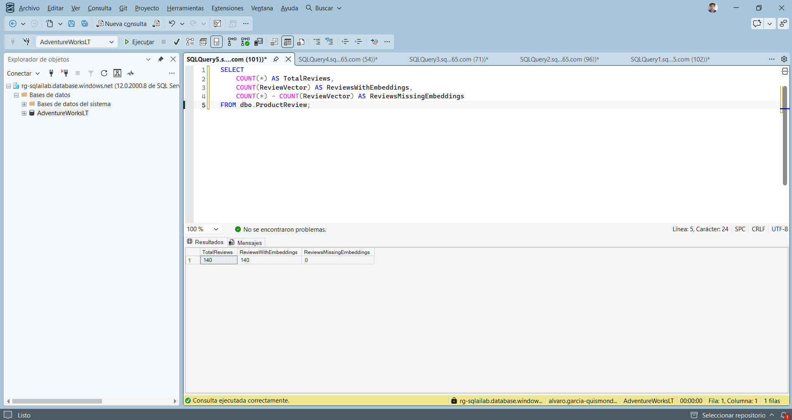
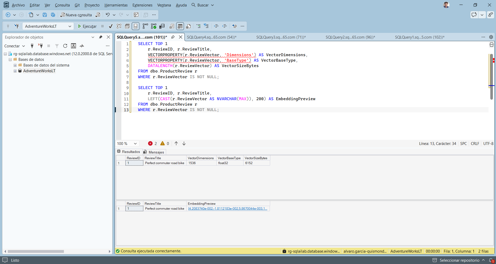
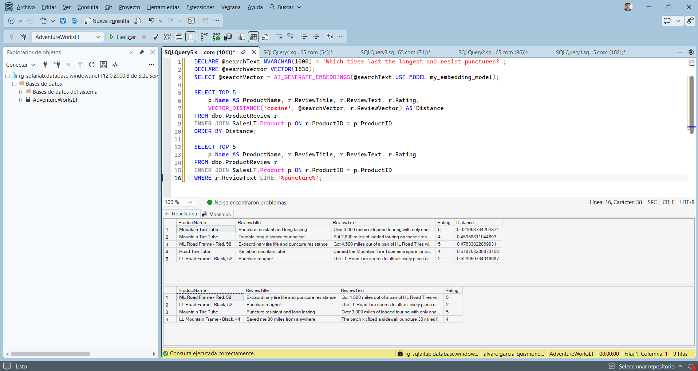
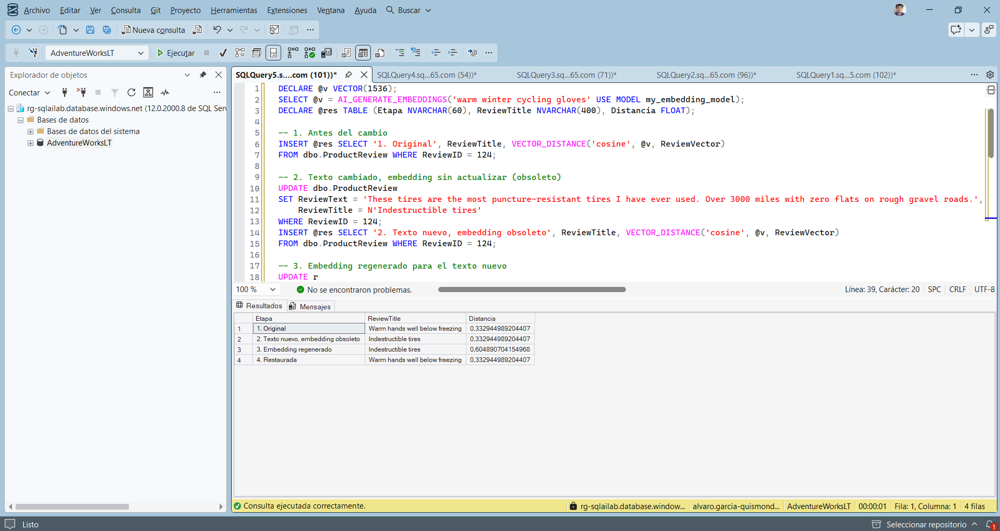
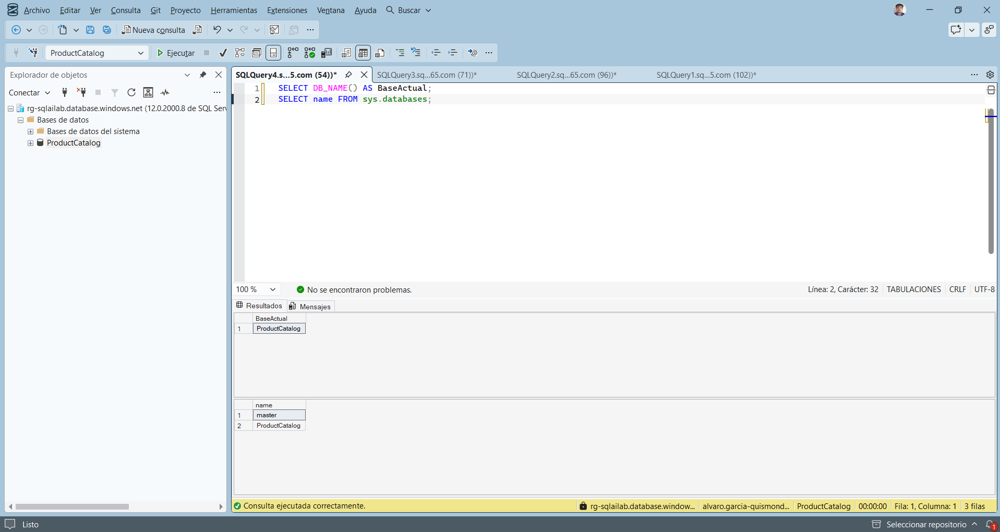

# Generación y mantenimiento de embeddings en Azure SQL Database

Generate and update embeddings in Azure SQL Database

Álvaro García-Quismondo Lizana · 26 de octubre de 2026

## Contenido

- 1. Objetivo y entorno
- 2. Verificación de los embeddings
- 3. Búsqueda semántica frente a palabra clave
- 4. Mantenimiento de embeddings
- 5. Resumen de incidencias
- 6. Observaciones
- 7. Archivos incluidos

## 1. Objetivo y entorno

En esta práctica compruebo los embeddings de texto que Azure SQL Database guarda en una columna `VECTOR(1536)`, valido con una búsqueda por similitud que capturan el significado y observo qué pasa con un embedding cuando cambia el texto del que salió. El enunciado trabaja sobre la tabla `dbo.ProductReview` de AdventureWorksLT, con 140 reseñas de productos.

Hice esta práctica después de las de búsqueda (lab 10) y RAG (lab 11), que partían del mismo entorno. Por eso el aprovisionamiento, la credencial con identidad administrada, el modelo externo `my_embedding_model`, la columna `ReviewVector` y la generación por lotes de los 140 embeddings ya estaban hechos y no los repetí. Esos scripts están en la entrega del lab 10 (`sql/01` y `sql/03`). En esta entrega van las comprobaciones, la búsqueda de validación y el mantenimiento de embeddings.

| Elemento | Valor |
|---|---|
| Suscripción | Azure for Students |
| Servidor SQL | rg-sqlailab.database.windows.net (autenticación Microsoft Entra) |
| Base de datos | AdventureWorksLT |
| Recurso de Azure OpenAI | proj-sqlailab-agql-resource |
| Modelo de embeddings | text-embedding-3-small (1536 dimensiones), expuesto en SQL como my_embedding_model |
| Tabla de trabajo | dbo.ProductReview, 140 reseñas, columna ReviewVector VECTOR(1536) |
| Cliente SQL | SQL Server Management Studio |

## 2. Verificación de los embeddings

### 2.1 Recuento

Primero compruebo que todas las reseñas tienen vector. `COUNT(ReviewVector)` ignora los nulos, así que la resta con el total da las reseñas sin embedding.

```sql
SELECT
    COUNT(*) AS TotalReviews,
    COUNT(ReviewVector) AS ReviewsWithEmbeddings,
    COUNT(*) - COUNT(ReviewVector) AS ReviewsMissingEmbeddings
FROM dbo.ProductReview;
GO
```

Las 140 reseñas tienen embedding y no falta ninguna.



*Figura 1. TotalReviews 140, ReviewsWithEmbeddings 140 y ReviewsMissingEmbeddings 0.*

### 2.2 Metadatos y muestra de un vector

`VECTORPROPERTY` devuelve las dimensiones y el tipo base del vector, y `DATALENGTH` su tamaño en bytes. La segunda consulta muestra los primeros 200 caracteres del vector convertido a texto.

```sql
SELECT TOP 1
    r.ReviewID, r.ReviewTitle,
    VECTORPROPERTY(r.ReviewVector, 'Dimensions') AS VectorDimensions,
    VECTORPROPERTY(r.ReviewVector, 'BaseType') AS VectorBaseType,
    DATALENGTH(r.ReviewVector) AS VectorSizeBytes
FROM dbo.ProductReview r
WHERE r.ReviewVector IS NOT NULL;

SELECT TOP 1
    r.ReviewID, r.ReviewTitle,
    LEFT(CAST(r.ReviewVector AS NVARCHAR(MAX)), 200) AS EmbeddingPreview
FROM dbo.ProductReview r
WHERE r.ReviewVector IS NOT NULL;
GO
```

El vector tiene 1536 dimensiones de tipo `float32` y ocupa 6152 bytes. El enunciado da unos 6148 bytes como cifra aproximada: 1536 dimensiones de 4 bytes son 6144, y los 8 bytes restantes son cabecera del tipo. La vista previa es un array JSON de números en notación científica, uno por dimensión.

SSMS subrayó en rojo `'Dimensions'` y `'BaseType'` y contó 2 errores en el editor, pero la consulta se ejecutó sin problemas. Es el análisis de IntelliSense, que no reconoce esos valores de `VECTORPROPERTY`.



*Figura 2. Metadatos del vector (1536, float32, 6152 bytes) y vista previa del embedding.*

## 3. Búsqueda semántica frente a palabra clave

Para ver si los embeddings capturan significado, genero el embedding de una pregunta en lenguaje natural y ordeno las reseñas por distancia coseno a ese vector. Después hago la misma búsqueda con `LIKE '%puncture%'`, que solo encuentra la palabra exacta.

```sql
DECLARE @searchText NVARCHAR(1000) = 'Which tires last the longest and resist punctures?';
DECLARE @searchVector VECTOR(1536);
SELECT @searchVector = AI_GENERATE_EMBEDDINGS(@searchText USE MODEL my_embedding_model);

SELECT TOP 5
    p.Name AS ProductName, r.ReviewTitle, r.ReviewText, r.Rating,
    VECTOR_DISTANCE('cosine', @searchVector, r.ReviewVector) AS Distance
FROM dbo.ProductReview r
INNER JOIN SalesLT.Product p ON r.ProductID = p.ProductID
ORDER BY Distance;

SELECT TOP 5
    p.Name AS ProductName, r.ReviewTitle, r.ReviewText, r.Rating
FROM dbo.ProductReview r
INNER JOIN SalesLT.Product p ON r.ProductID = p.ProductID
WHERE r.ReviewText LIKE '%puncture%';
GO
```

La pregunta es «Which tires last the longest and resist punctures?». Estos son los 5 resultados de la búsqueda vectorial:

| Producto | Título de la reseña | Valoración | Distancia |
|---|---|---|---|
| Mountain Tire Tube | Puncture resistant and long lasting | 5 | 0,3220 |
| Mountain Tire Tube | Durable long-distance touring tire | 4 | 0,4596 |
| ML Road Frame - Red, 58 | Extraordinary tire life and puncture resistance | 5 | 0,4763 |
| Road Tire Tube | Reliable mountain tube | 4 | 0,5188 |
| LL Road Frame - Black, 52 | Puncture magnet | 2 | 0,5210 |

Todas son reseñas de neumáticos, cámaras o pinchazos. La búsqueda con `LIKE` devuelve 4 filas, y la reseña «Durable long-distance touring tire», la segunda de la búsqueda vectorial, no está entre ellas: no contiene la palabra «puncture» pero habla del mismo tema. Al revés, «Saved me 30 miles from anywhere» sale por `LIKE` y la búsqueda vectorial no la trae entre las 5 primeras.



*Figura 3. Arriba, las 5 reseñas más cercanas por distancia coseno. Abajo, las 4 que contienen la palabra puncture.*

Hay dos detalles de los resultados. El quinto resultado, «Puncture magnet», tiene valoración 2: es una reseña negativa sobre pinchazos. La distancia mide cercanía de tema, no de opinión, así que una reseña que critica el producto puede salir en una pregunta sobre durabilidad. Además, algunas filas tienen un producto que no encaja con el contenido, por ejemplo una reseña de neumáticos asociada a «ML Road Frame - Red, 58». Es algo de los datos de ejemplo y no de la búsqueda.

## 4. Mantenimiento de embeddings

Un embedding es una copia del significado del texto en el momento en que se generó. Si el texto cambia y el vector no, deja de corresponderse con él. Lo compruebo con la reseña 124, que habla de guantes de invierno, midiendo su distancia a la consulta «warm winter cycling gloves» en cuatro momentos.

El enunciado lo hace en cinco pasos sueltos. Los reuní en un único script que ejecuta las mismas sentencias en el mismo orden y guarda cada medida en una variable de tabla. Así queda una sola tabla final con las cuatro distancias:

- **1. Original:** distancia con el texto y el embedding originales.
- **2. Texto nuevo, embedding obsoleto:** cambio el texto y el título a una reseña sobre neumáticos sin tocar `ReviewVector`.
- **3. Embedding regenerado:** recalculo el vector con el texto nuevo.
- **4. Restaurada:** devuelvo el texto original y regenero su embedding, para que los datos queden como estaban para los demás labs.

```sql
DECLARE @v VECTOR(1536);
SELECT @v = AI_GENERATE_EMBEDDINGS('warm winter cycling gloves' USE MODEL my_embedding_model);
DECLARE @res TABLE (Etapa NVARCHAR(60), ReviewTitle NVARCHAR(400), Distancia FLOAT);

-- 1. Antes del cambio
INSERT @res SELECT '1. Original', ReviewTitle, VECTOR_DISTANCE('cosine', @v, ReviewVector)
FROM dbo.ProductReview WHERE ReviewID = 124;

-- 2. Texto cambiado, embedding sin actualizar (obsoleto)
UPDATE dbo.ProductReview
SET ReviewText = 'These tires are the most puncture-resistant tires I have ever used. Over 3000 miles with zero flats on rough gravel roads.',
    ReviewTitle = N'Indestructible tires'
WHERE ReviewID = 124;
INSERT @res SELECT '2. Texto nuevo, embedding obsoleto', ReviewTitle, VECTOR_DISTANCE('cosine', @v, ReviewVector)
FROM dbo.ProductReview WHERE ReviewID = 124;

-- 3. Embedding regenerado para el texto nuevo
UPDATE r
SET r.ReviewVector = AI_GENERATE_EMBEDDINGS(p.Name + ' - ' + r.ReviewTitle + ': ' + r.ReviewText USE MODEL my_embedding_model)
FROM dbo.ProductReview r
INNER JOIN SalesLT.Product p ON r.ProductID = p.ProductID
WHERE r.ReviewID = 124;
INSERT @res SELECT '3. Embedding regenerado', ReviewTitle, VECTOR_DISTANCE('cosine', @v, ReviewVector)
FROM dbo.ProductReview WHERE ReviewID = 124;

-- 4. Restaurar la reseña original y su embedding
UPDATE dbo.ProductReview
SET ReviewTitle = N'Warm hands well below freezing',
    ReviewText = N'Rode through an entire winter with the Full-Finger Gloves and never had cold fingers even at minus 5 degrees with wind chill. The fleece lining is cozy without being bulky and I can still operate my brake levers precisely. Essential cold weather gear.'
WHERE ReviewID = 124;
UPDATE r
SET r.ReviewVector = AI_GENERATE_EMBEDDINGS(p.Name + ' - ' + r.ReviewTitle + ': ' + r.ReviewText USE MODEL my_embedding_model)
FROM dbo.ProductReview r
INNER JOIN SalesLT.Product p ON r.ProductID = p.ProductID
WHERE r.ReviewID = 124;
INSERT @res SELECT '4. Restaurada', ReviewTitle, VECTOR_DISTANCE('cosine', @v, ReviewVector)
FROM dbo.ProductReview WHERE ReviewID = 124;

SELECT * FROM @res;
GO
```

| Etapa | Título de la reseña | Distancia |
|---|---|---|
| 1. Original | Warm hands well below freezing | 0,33294 |
| 2. Texto nuevo, embedding obsoleto | Indestructible tires | 0,33294 |
| 3. Embedding regenerado | Indestructible tires | 0,60489 |
| 4. Restaurada | Warm hands well below freezing | 0,33294 |

En la etapa 2 el texto ya habla de neumáticos, pero la distancia es idéntica a la de la etapa 1, porque el vector guardado sigue siendo el de los guantes. Una búsqueda de guantes seguiría devolviendo esta reseña. Al regenerar el embedding (etapa 3) la distancia sube de 0,33 a 0,60, que es lo que cabe esperar de un texto sobre otro tema. En la etapa 4 vuelve exactamente al valor inicial, con todos sus decimales: regenerar el embedding del mismo texto da el mismo vector.



*Figura 4. Tabla final del script con las cuatro distancias. El editor solo enseña el principio del script, completo en el bloque de código de arriba.*

## 5. Resumen de incidencias

| Incidencia | Causa | Solución |
|---|---|---|
| Error 208, Invalid object name dbo.ProductReview | La conexión de SSMS estaba abierta contra ProductCatalog (lab 08) y no contra AdventureWorksLT | Nueva conexión indicando AdventureWorksLT en «Conectar a la base de datos» |

Para comprobarlo ejecuté `SELECT DB_NAME()`, que devolvió `ProductCatalog`. Desde una base de usuario de Azure SQL, `sys.databases` solo muestra `master` y la propia base, así que esa consulta no sirve para saber si existe otra.



*Figura 5. DB_NAME() devuelve ProductCatalog: la consulta se estaba ejecutando en la base equivocada.*

## 6. Observaciones

No repetí en este lab la prueba de generar un embedding para una sola reseña ni la generación por lotes con reintentos, porque ya se ejecutaron en el lab 10 con el mismo script. Aquí solo compruebo su resultado.

La tabla ya tenía el índice vectorial `IX_Review_ReviewVector` del lab 10. Las sentencias `UPDATE` de la sección 4 se ejecutaron sin error con él creado. No comprobé si el índice refleja esos cambios.

El enunciado menciona automatizar la regeneración con desencadenadores, Change Tracking, Change Data Capture o procesos externos. En esta práctica la regeneración fue manual y no implementé ninguna automatización.

No hice la limpieza del final del enunciado. Sus recursos son los mismos de los labs 10 y 11, y el propio texto avisa de que se usan en ellos.

## 7. Archivos incluidos

| Archivo | Contenido |
|---|---|
| sql/01-recuento-embeddings.sql | Recuento de reseñas con embedding |
| sql/02-metadatos-vector.sql | Dimensiones, tipo, tamaño y vista previa del vector |
| sql/03-busqueda-semantica-vs-keyword.sql | Búsqueda por distancia coseno y búsqueda con LIKE |
| sql/04-mantenimiento-embeddings.sql | Cambio de texto, embedding obsoleto, regeneración y restauración |
